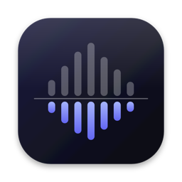
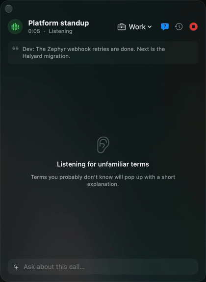

<p align="center"></p>

# Undertone

**Know what everyone means, and what to say next.**

Undertone is a macOS app that listens along to your calls, in a small panel beside the call:

- **During the call:** code names, acronyms and internal projects are explained the moment they come up, from your team's own Slack, Notion, Jira and other tools.
- **When you're asked:** the facts and context you need come up as reminders, so you can answer in your own words.
- **Before and after:** a briefing for the next meeting, then the recap, your tasks, a follow-up draft and new terms to learn.

Speech is transcribed on your Mac. Work and personal meetings are kept apart, and you can try it on a made-up sample meeting before your first real call.

<p align="center"><a href="https://getundertone.app/#video"></a></p>
<p align="center"><a href="https://getundertone.app/#video">▶ Watch the 90-second demo</a> · made-up meeting, names and tickets</p>

**Website and download:** https://getundertone.app · or `brew install --cask sslugic/tap/undertone` (run `brew trust sslugic/tap` once first)

- Free during the beta, with your own AI: an OpenAI, Anthropic or Gemini key, a local Ollama or LM Studio model, or your Claude Code or Cursor sign-in.
- macOS 26 or later on Apple silicon. Signed and notarized by Apple.

## What this repository is for

The Undertone app is closed source. This public repository holds:

- **[Releases](https://github.com/sslugic/undertone/releases):** the notarized `.dmg` for every version, with release notes.
- **[Issues](https://github.com/sslugic/undertone/issues):** bug reports and feature requests.
- **[SECURITY.md](SECURITY.md):** what leaves your Mac, what doesn't, and how to check it yourself.
- **[DATA.md](DATA.md) and [schemas/](schemas):** every file Undertone stores on your Mac and its format.
- **[docs/](docs):** the website.

## Website translations

The site is available in 17 languages. `docs/index.html` is the English source; `docs/<code>/index.html` pages are generated. After editing the English page, run:

```sh
python3 tools/i18n.py          # refresh docs/i18n/en.json and rebuild every language page
python3 tools/i18n.py check    # list missing or invalid translations
```

New or changed strings fall back to English until their keys are added to `docs/i18n/<code>.json`.

## Privacy in one paragraph

Calls and your microphone are transcribed on your Mac with Apple's speech recognition; audio is never uploaded. Text from the call goes only to the AI you choose, and Undertone only reads from the tools you connect (it never sends, posts or edits). There is no Undertone server, account or telemetry. Everything Undertone keeps is stored as files in `~/Library/Application Support/Undertone`, and keys stay in your Keychain. See [SECURITY.md](SECURITY.md) for how to verify this with a network monitor.

## Reporting a problem

Open an [issue](https://github.com/sslugic/undertone/issues) with your macOS version, Undertone version (Profile & Settings) and what happened. Please don't paste meeting transcripts or anything confidential. For security issues, see [SECURITY.md](SECURITY.md).

## Publishing the site

The site is served at https://getundertone.app by a Cloudflare Worker (`wrangler.toml`). After editing `docs/index.html`:

    python3 tools/i18n.py
    npx wrangler deploy

Pushing to GitHub only updates the old GitHub Pages address, which forwards to getundertone.app.
